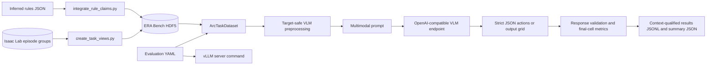

# ERA Bench evaluation architecture

This repository evaluates models on embodied ARC tasks recorded with Isaac Lab. Its current model adapter targets vision-language models served through an OpenAI-compatible vLLM or vllm-mlx endpoint.

The central abstraction is not a single recorded episode. It is one ARC task sample: all solved demonstrations for a task plus one held-out test pair. If an ARC task has multiple test pairs, the dataset exposes one sample per test pair and reuses the same demonstrations.

## System overview



The server and evaluator are deliberately separate processes. `scripts/serve_vllm.py` translates the shared YAML into a server command and replaces itself with that process. `scripts/evaluate_vlm.py` loads the same YAML, calls the server over HTTP, and writes evaluation artifacts.

## HDF5 preparation and layout

The raw recorder layout is episode-centric:

```text
/data/demo_<global episode index>/
  actions                               float32 [T, 12]
  processed_actions                     float32 [T, 13]
  high_level_actions/
    action_timeline                     int64 [1, T, 5]
  obs/
    actions                             float32 [T, 12]
    eef_pos                             float32 [T, 3]
    eef_quat                            float32 [T, 4]
    gripper_pos                         float32 [T, 2]
    joint_pos                           float32 [T, 9]
    joint_vel                           float32 [T, 9]
    table_cam                           uint8   [T + 1, 252, 336, 3]
    table_cam_depth                     float32 [T + 1, 252, 336, 1]
    table_cam_semantic_segmentation     uint8   [T + 1, 252, 336, 4]
    origin_top_cam                      uint8   [T + 1, 280, 280, 3]
    wrist_cam                           uint8   [T + 1, 112, 112, 3]
    wrist_cam_depth                     float32 [T + 1, 112, 112, 1]
    wrist_cam_semantic_segmentation     uint8   [T + 1, 112, 112, 4]
  initial_state/
    articulation/robot/{joint_position, joint_velocity, root_pose, root_velocity}
    rigid_object/<object>/{root_pose, root_velocity}
  states/
    articulation/robot/{joint_position, joint_velocity, root_pose, root_velocity}
    rigid_object/<object>/{root_pose, root_velocity}
  task_info/{task_id, task_pair}
/rules/<task_id>/data                   UTF-8 JSON
```

Here, `T` is the control/state trajectory length. The camera streams normally
contain the initial visual observation plus one frame per control timestep;
the recorder therefore commonly stores `T + 1` camera frames. `initial_state`
is the single starting simulator snapshot, whereas `states` records the
trajectory of the same robot and rigid-object quantities. Object names are
scene-dependent (for example, input-grid and reserve cubes), so the
`rigid_object/<object>` branch is not a fixed enumeration.

The current evaluator deliberately loads only selected RGB camera streams,
`high_level_actions/action_timeline`, and task-view ARC grids and rule metadata.
The raw `task_info` is consumed while creating those views. The low-level
action/control arrays, proprioception, depth/semantic streams, and simulator
states are nevertheless preserved in the raw source episodes and remain
available for replay, control-policy, state- or multimodal-perception, and
recorder-validation work. Task views use hard links precisely so this full
episode record remains available without copying it.

`scripts/integrate_rule_claims.py` validates the inferred-rules JSON with the
Pydantic models in `src/rule_models.py`, writes `/rules`, and removes the legacy
`/data/rules` location. This is dataset-maintenance infrastructure; rules are not
currently included in model prompts or metrics.

`scripts/create_task_views.py` transforms the episode-centric index into task-centric views without duplicating episode payloads:

```text
/data/<task_id>/                        view_type=era_bench_task_view_v1
  demo_0 -> /data/demo_<n>              HDF5 hard link
  demo_1 -> /data/demo_<m>              HDF5 hard link
  test_0 -> /data/demo_<k>              HDF5 hard link
  test_1 -> /data/demo_<j>              optional additional test pair
  rule -> /rules/<task_id>              HDF5 hard link
  arc_grids/
    demo_0/{input_grid,output_grid}      copied canonical ARC arrays
    test_0/{input_grid,output_grid}
```

Unique task-pair indices must be contiguous from zero. If the recorder contains multiple source episodes for the same pair, the script warns and links the earliest episode; later duplicates remain untouched in the raw source layout. The script obtains the number of test pairs from `arc_utils`, assigns the final recorded pairs to `test_<n>`, and treats preceding pairs as demonstrations. It will only overwrite groups carrying its own `view_type` marker. Use `--dry-run` before modifying a valuable dataset.

After task views exist, evaluation depends only on the HDF5 file. The runtime evaluator does not import `arc_utils`.

## Evaluation data flow

### 1. Typed configuration

`src/evaluations/evaluation_config.py` parses a YAML file into immutable
dataclasses:

- `dataset`: HDF5 paths, frame stride, and nominal sampled FPS.
- `model`: Hugging Face model ID, served name, executable, and server arguments.
- `env_file`: optional dotenv file, resolved beside the YAML; an existing
  project-root `.env` is discovered automatically when the setting is omitted.
- `server`: OpenAI-compatible base URL, optional literal or environment-backed
  API key, and timeout.
- `generation`: token-field dialect, decoding values, structured-output toggle, and arbitrary request overrides.
- `evaluation`: output directory, optional sample limit, error policy, prompt
  focus, selected cameras, enabled prompt context, rule-summary induction, and
  scene-description induction. Output mode is derived from the prompt focus.

Relative dataset and output paths are resolved relative to the YAML file, not the current working directory. Server arguments are translated generically from YAML keys to `--<key>` CLI options. This is what permits separate CUDA vLLM and Apple Silicon vllm-mlx configurations.

### 2. Dataset discovery and lazy loading

`ArcTaskDataset`, implemented in `src/datasets/dataset.py`, scans `/data`,
ignores the raw `/data/demo_<n>` groups, and discovers task views. It stores
lightweight `TaskRef` entries and reopens the corresponding HDF5 file only when
`__getitem__` loads a sample. The `src/datasets/__init__.py` package facade
re-exports the public dataset and action types.

Each returned `ArcTaskSample` contains:

- all `ArcDemonstration` objects, including grids, sampled RGB frames, and recorded high-level actions;
- one `ArcTestCase`, including its input grid, RGB frames, and scoring targets;
- `task_id` and `test_key` identity.

Frame selection happens as an HDF5 indexed read, before conversion to a Torch
tensor. The default evaluator selects every `frame_stride` frame and always
retains the last frame. `evaluation.cameras` can select `table_cam`,
`origin_top_cam`, or both. When demonstration videos are enabled, the evaluator
also loads `table_cam` because videos always use that perspective.

### 3. Target-safe preprocessing

The in-memory dataset item contains test targets because the evaluator needs
them later for scoring. `prepare_vlm_task()` is the target-isolation boundary:

- demonstrations keep their sampled frame sequences, grid dimensions, and compressed semantic actions;
- the test keeps only its first selected RGB frame and input-grid dimensions;
- the test output grid, later frames, and expected action timeline are absent
  from the model-facing data;
- `task_id` and `test_key` remain on `VLMTaskInput` for orchestration, but the
  prompt builder does not serialize them into messages.

The recorded action vector is:

```text
[phase, color_id, location_type, row, column]
phase:         0=no action, 1=grasp, 2=place
location_type: 0=reserve,   1=output grid
```

`compress_action_timeline()` run-length-encodes consecutive identical vectors and drops phase-zero runs. The model therefore sees semantic actions, not repeated control-rate actions.

### 4. Multimodal prompt construction

`src/vlm_images.py` converts a standard demonstration frame sequence into the
Qwen/vLLM in-memory video representation: a `data:video/jpeg;base64,...` URL
containing comma-separated JPEG payloads. Videos always use `table_cam`. The
final-frame ablation encodes the last frame from each selected camera as a PNG;
test images always use the first selected frame from each selected camera.

`src/vlm_prompts.py` assembles a system message from stable atomic sections and
then builds ordered user content per demonstration. `prompt_mode: embodied`
(the default) derives action output and always includes the action section;
`prompt_mode: grid_focused` derives direct grid output and always includes the grid
section. The optional contexts are `include_frames`, `include_textual_grids`,
`include_final_frames`, and `include_actions`:

1. Videos add a table-camera video for each demonstration. Final frames add a
   labelled last-frame image for every selected camera. These PNG images,
   including selected initial test views, are always nearest-neighbor upscaled
   4×; videos are unchanged.
   The two visual contexts can be used alone or together.
2. Grids add textual demonstration input/output pairs and the test input grid.
3. Actions add named, compressed demonstration actions and their descriptions.
4. The core/output section and response instruction are always present.

The action context explains the same action representation wherever it is
enabled, including as the embodied core output. Likewise, the grid context uses
the same grid and color explanation wherever it is enabled. This keeps ablation
differences limited to enabled context and position rather than rewritten text.

The response schema is selected from strict Pydantic models in
`src/vlm_actions.py`. Every response contains either an `actions` list or an
`output_grid`. It additionally contains `rule_summary` when
`evaluation.induce_rule_summary` is enabled and `scene_descriptions` when
`evaluation.induce_scene_descriptions` is enabled. Scene descriptions are
qualitative input/output-grid descriptions for every demonstration followed by
a brief comparison. Runs including the demos videos explicitly exclude robot motion and intermediate
events from this field in the prompt; that video-specific exclusion is absent for
final-frame-only and text-only runs. The evaluator records any declared rule
summary and scene descriptions, the task's ground-truth rule, and the endpoint's
optional `reasoning` or `reasoning_content` response in the context-qualified
results JSONL for analysis only; none of them is used by validation or any metric. Extra
fields and coercion from numeric enum values are rejected.

`embodied` prompts produce actions, always include demonstration actions, and
must expose the task through at least one of videos, final frames, or textual
grids. `grid_focused` prompts produce a direct output grid and always include
textual grids; they may optionally add frames and/or actions. These variants
reuse the same target-safe prepared input, client, response schema selection,
and final-cell metrics.

`evaluation.induce_rule_summary` controls whether either prompt explicitly asks
the model to state the inferred rule before its answer. It defaults to `true`.
When disabled, `rule_summary` is also removed from the strict response schema;
the corresponding result field is recorded as `null`.

`evaluation.induce_scene_descriptions` independently adds the structured scene
description field and its prompt scaffold. It defaults to `false`.

### 5. vLLM transport

`VLLMClient` uses the standard-library HTTP client to call `<base_url>/chat/completions`. It can therefore target either local vLLM or a hosted OpenAI-compatible provider such as OpenRouter. It adds configured sampling fields, an optional seed, arbitrary request overrides, and an OpenAI-style strict JSON schema when structured output is enabled. The small internal Pydantic response models validate only the response surface the evaluator consumes. The configuration loader first reads an optional dotenv file without replacing shell-provided values, so hosted credentials can be named with `server.api_key_env_name`; it fails before evaluation if that environment variable is unset. `HF_TOKEN` loaded this way is inherited by local vLLM for private or gated Hugging Face models.

The comma-separated JPEG `data:video/jpeg` representation is specific to the
local vLLM/Qwen processor path. Hosted providers may require standard video
content types and model-specific routing. The `include_final_frames`
mode uses ordinary PNG `image_url` content and is the portable visual option for
OpenRouter-compatible image models.

The CUDA configuration passes video sampling through `mm_processor_kwargs.fps`. The MLX configuration uses its different request and server option names. `dataset.sampled_fps` is currently descriptive configuration; it is not automatically copied into the request. Keep it consistent with the relevant generation override.

### 6. Scoring and persistence

The evaluator parses model JSON with Pydantic. In action mode it simulates the
semantic actions into a sparse map of colored output cells; in grid mode it
converts the predicted and canonical grids into the same non-black cell
representation. It separately reports:

- `exact_match`: predicted and expected final colored-cell maps are identical;
- `occupancy_exact_match`: predicted and expected occupied output-cell coordinates are identical, regardless of cube color;
- `valid_action_sequence` in action mode: parsing and the implemented
  grasp/place consistency rules succeed;
- `valid_grid` in grid mode: the direct-grid response parses successfully;
- colored-cell and occupied-cell precision, recall, and F1;
- color-sensitive and color-agnostic true-positive, false-positive, and false-negative cell counts;
- parse and validation errors.

Aggregate colored-cell and occupied-cell metrics are micro-averaged across all
successfully scored samples. A task is counted as solved only when every scored
test sample for that `task_id` is an exact match; summaries report both the
solved-task count and percentage. Each run rewrites
`results_<artifact-suffix>.jsonl`, flushes it after every sample, and writes
`summary_<artifact-suffix>.json` at the end. The suffix identifies output mode,
prompt mode, enabled contexts, non-default cameras, and induction ablations so
experiment variants do not overwrite each other. With `continue_on_error:
false`, the failing record is persisted before the exception is reraised; with
it enabled, errors are counted and evaluation proceeds.

`scripts/run_experiments.py` constructs predefined grid-focused or embodied
prompt-context sweeps from one loaded configuration. Every generated
configuration passes through the same `EvaluationRunConfig` normalization and
the same evaluator; it is orchestration rather than a separate evaluation path.

### 7. Visual grid-perception diagnostic

`scripts/diagnose_grid_perception.py` is intentionally independent of the ARC
solution ablations. It evaluates one physical episode per request, avoiding the
many-video/many-array binding problem. A demonstration is shown as either its
complete final frame or its sampled video and returns one input/output pair. A
test is shown only as its complete initial frame and returns one input grid. The
prompt contains no textual grid values, action traces, rule request, or test
target, and no scene is cropped.

Both diagnostic video conditions reuse the dataset's existing
`uniform_frame_indices(frame_stride)` selection. `sampled_frames` sends those
frames through the existing comma-separated JPEG video representation;
`sampled_video` encodes the identical selected tensors as one MP4 at
`dataset.sampled_fps`. Both set `mm_processor_kwargs.fps` to that same value, so
the condition changes representation rather than frame selection. The
`final_frame` condition sends the last selected demonstration frame as an image.
Structured-schema and ordinary JSON response modes are independently selectable.
The `scene_then_structured` mode is a third prompt ablation: it requires one
integrated scene description using ordinary color names before strict numeric
grid fields, and records that description alongside the scored transcription.
All diagnostic media can be nearest-neighbor upscaled as a whole-scene
ablation; the scale factor is recorded in output artifact names and metadata.
The diagnostic CLI's optional run seed controls both task shuffling and model
generation. When omitted, it uses `generation.seed`, falling back to `0` when
that setting is null, so one seed reproduces the complete diagnostic condition.

The diagnostic `cameras` parameter accepts `table_cam`, `origin_top_cam`, or
both. `ArcTaskDataset.cameras` selects which `obs/<camera>` tensors to load and
defaults to `table_cam`. Its samples expose the requested data as
`table_cam_rgb_frames` and `origin_top_cam_rgb_frames`, rather than a single
ambiguous frame field. In the two-camera condition the prompt labels both
synchronized perspectives but asks for only one transcription of each grid.

Diagnostic scoring uses exact nested-array equality, including dimensions,
zeros, colors, and cell order. It reports exact rates separately for
demonstration inputs, demonstration outputs, and test inputs, plus overall and
all-grids exact rates. It does not invoke action simulation or the task-output
grid metric.

`scripts/diagnose_scene_description.py` reuses the same task selection, camera
loading, final demonstration frames, and initial test frames, but makes a
schema-free request for a detailed visual cube inventory. It asks for ordinary
color names, explicit row/column positions, occlusions, uncertainties, reserve
stacks, and region-specific confidence without requesting numeric arrays or an
ARC solution. Its artifacts include the exact PNG bytes attached to every
request, dimensions and SHA-256 hashes, canonical grids for later analysis, and
the complete free-form response.

## Metric semantics and important boundaries

- Exact match evaluates the final sparse colored-cell map, not action order. Different valid plans can therefore score equally.
- Occupancy metrics drop `color_id` before comparing final cells. They diagnose correct target coordinates with wrong cube colors, but do not score output-grid dimensions.
- Black cells are implicit absence. Action responses have no output-dimension
  field, and direct grids are reduced to non-black cells before scoring, so
  output-grid dimensions are not independently scored in either mode.
- Action-sequence validity is intentionally softer than a full robot execution validator. Consecutive grasps and a trailing grasp are accepted; color mismatch, place-without-grasp, invalid coordinates, and occupied-cell placement are reported.
- Coordinates are constrained to `[0, 7]` for output actions and `-1, -1` for reserve actions.
- In action mode, expected cells come from the recorded high-level action
  timeline. In grid mode, they come from the canonical `expected_output_grid`.
- The target-safe contract is enforced by preprocessing and prompt tests, not by removing targets from the dataset object.
- The rule metadata stored in HDF5 is recorded as `ground_truth_rule` in results, but is not used for scoring.

## Module ownership

| Area | Primary files | Responsibility |
| --- | --- | --- |
| Dataset maintenance | `scripts/integrate_rule_claims.py`, `scripts/create_task_views.py`, `src/rule_models.py` | Enrich HDF5 and create task views |
| Dataset API | `src/datasets/dataset.py`, `src/datasets/__init__.py` | Discover samples and load frames, grids, actions; expose the package API |
| Action representation | `src/datasets/actions.py`, `src/vlm_actions.py` | Timeline compression and strict named actions/responses |
| Prompt boundary | `src/vlm_preprocessing.py`, `src/vlm_images.py`, `src/vlm_prompts.py` | Prevent target leakage and assemble embodied or text-only requests |
| Inference infrastructure | `src/evaluations/evaluation_config.py`, `src/vllm/vllm_server.py`, `src/vllm/vllm_client.py` | YAML parsing, server launch, HTTP requests |
| Evaluation | `src/evaluations/evaluator.py`, `src/evaluations/evaluation_metrics.py` | Loop, per-sample records, action/grid scoring, aggregation |
| Perception diagnostics | `src/evaluations/grid_perception_diagnostic.py`, `scripts/diagnose_grid_perception.py`, `scripts/diagnose_scene_description.py` | Exact grid transcription and schema-free visual cube descriptions |
| Entry points and sweeps | `scripts/serve_vllm.py`, `scripts/evaluate_vlm.py`, `scripts/run_experiments.py` | User-facing server, evaluation, and ablation commands |
| Offline video export | `scripts/create_videos.py` | Render selected raw HDF5 camera streams as MP4 files for inspection |

## Extension guide

When adding a new VLM served through the same API, prefer a new YAML configuration. Extend Python only when the server uses a genuinely different wire protocol or multimodal content representation.

When adding another model backend, preserve the boundary between model-agnostic task preparation and backend-specific transport. A backend should consume `VLMTaskInput` or the structured messages and return response text without taking ownership of scoring.

When adding a prompt ablation, compose existing atomic prompt sections when
possible. Reuse the dataset, target-safe preprocessing, response schema,
transport, and scoring unless the ablation changes one of those contracts. Keep
the wording of an enabled context section identical across prompt focuses; only
its position may vary. Artifact names must identify every enabled context so
comparisons cannot overwrite one another.

When adding metrics, decide whether they measure the action trajectory, the
final sparse cell state, or the canonical output grid. These are distinct
contracts in the current system. Add per-sample fields to `SampleScore.to_dict()`
and aggregate fields to `aggregate_scores()` in
`src/evaluations/evaluation_metrics.py` together.

When changing frame sampling, keep these three concepts explicit:

- HDF5 frame selection (`dataset.frame_stride`);
- the FPS declared to the model processor (currently a generation request override);
- which test frame is exposed (currently the first selected frame).

The repository has unit coverage for data discovery/loading, action compression,
prompt leakage boundaries, image/video encoding, configuration dialects, vLLM
request construction, metric behavior, task-view and offline-video creation,
experiment configuration, perception diagnostics, and a stubbed end-to-end
evaluator. Live model serving is not part of the unit tests.
